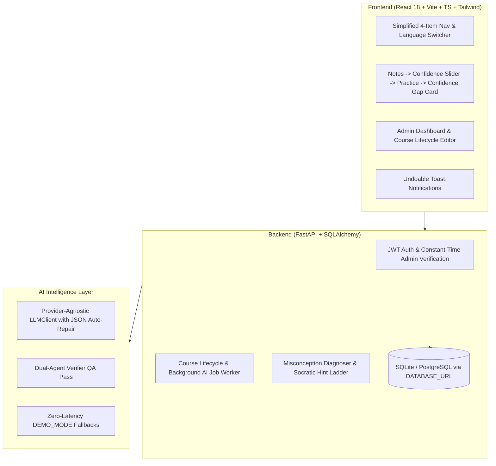

# 🎯 BLINDSPOT: Real-World Conceptual Practice & Confidence Gap Diagnostics
*Built for the **ForgeHacks 2026 Hackathon** — Track: **AI + Education***

[](https://blindspot-livid.vercel.app)
[](https://blindspot-api-pbim.onrender.com/docs)
[](https://github.com/KEERTHANASRI572/blindspot)

### 🌐 Live Deployment
- 🔗 **Frontend Web App:** [https://blindspot-livid.vercel.app](https://blindspot-livid.vercel.app)
- ⚙️ **Backend REST API & Swagger:** [https://blindspot-api-pbim.onrender.com/docs](https://blindspot-api-pbim.onrender.com/docs)
- 💚 **Health Endpoint:** [https://blindspot-api-pbim.onrender.com/health](https://blindspot-api-pbim.onrender.com/health)

---

## 1. Product Overview: The "Fluency Illusion" in Learning
Students regularly confuse **familiarity** (*"I recognize this term from the notes"*) with **deep mental schema mastery** (*"I can diagnose and apply this under novel real-world constraints"*).

**BLINDSPOT** makes that gap visible and bridges it:
1. **Real-Life Practice Scenarios**: Instead of multiple-choice recall, students solve everyday dilemmas (e.g. food delivery traffic jams for Deadlock) generated from lecture notes.
2. **Confidence Gap Metric**: $\text{Confidence Gap} = \text{Confidence}_{\text{declared}} - \text{Score}_{\text{actual}}$. Exposes overconfidence and imposter syndrome.
3. **Socratic Hint Ladder**: 4 progressive clues (Guiding Question $\to$ Analogy $\to$ Walkthrough $\to$ Solution) that coach the student without giving away answers upfront.
4. **Trilingual Localization**: Full UI and question parity across **English**, **தமிழ் (Tamil)**, and **हिंदी (Hindi)**.
5. **Course Lifecycle Management**: Complete Admin dashboard to draft, generate AI questions, publish, unpublish, duplicate, archive/restore, or permanently delete courses.

---

## 2. Architecture & Tech Stack



### Stack Details
- **Frontend**: React 18, Vite, TypeScript, Tailwind CSS, `react-i18next`, Lucide Icons, `html2canvas`, Recharts.
- **Backend**: Python 3.10+, FastAPI, Pydantic v2, SQLAlchemy (SQLite local, PostgreSQL in production).
- **Authentication**: JWT with constant-time Admin password verification via `ADMIN_PASSWORD` env var. User signup/login with rate-limited brute force protection.
- **AI & Fallbacks**: Google Gemini API via provider-agnostic `LLMClient` with Pydantic JSON validation, 2-retry JSON repair loop, and instantaneous `DEMO_MODE` fallback.

---

## 3. Roles & Course Management Lifecycle

### A. Roles & Permissions
- **Learner (`role: "user"`)**:
  - Signs up / logs in with email and password.
  - Sees **only published courses** (draft and archived courses are strictly filtered at the database query level).
  - Practices scenarios, rates confidence, receives Socratic hints, and tracks personal calibration over time.
- **Admin (`role: "admin"`)**:
  - Authenticates exclusively using the server-configured `ADMIN_PASSWORD`.
  - Creates courses and triggers background AI scenario & translation generation.
  - Manages course lifecycle: Draft $\leftrightarrow$ Published $\leftrightarrow$ Cancelled $\leftrightarrow$ Delete (with typed title confirmation).

### B. Course Lifecycle Statuses
| Status | Learner Visibility | Admin Capabilities |
|---|---|---|
| **Draft** | Hidden | Editable, question generation, preview, publish |
| **Published** | Visible to all students | Unpublish to draft, edit notes/translations |
| **Cancelled** | Hidden | Learner history preserved; admin can **Restore** to draft |
| **Deleted** | Permanently removed | Requires typing the exact course title; cascades to questions and attempts |

---

## 4. Getting Started Locally

### Prerequisites
- Python 3.10+
- Node.js 18+

### Step 1: Backend Setup
```bash
cd backend
python -m venv venv

# Windows
.\venv\Scripts\activate
# Linux/macOS
source venv/bin/activate

pip install -r requirements.txt

# Environment variables
cp .env.example .env
# Set ADMIN_PASSWORD=admin123 and GEMINI_API_KEY if available (or DEMO_MODE=true)

# Run backend
uvicorn main:app --reload --port 8000
```

### Step 2: Frontend Setup
```bash
cd frontend
npm install
npm run dev
```
Open `http://localhost:5173` in your browser.

---

## 5. Environment Variables Reference

| Variable | Required | Default | Description |
|---|---|---|---|
| `ADMIN_PASSWORD` | **Yes** | `admin123` | Master password for admin portal login (constant-time compared) |
| `JWT_SECRET` | **Yes** | `blindspot_jwt_super_secret_key` | Secret key used to sign and verify JWT tokens |
| `DATABASE_URL` | Optional | `sqlite:///./blindspot.db` | Database URL (set to PostgreSQL Neon / Supabase in production) |
| `GEMINI_API_KEY` | Optional | `""` | Google Gemini API key for real-time scenario generation |
| `DEMO_MODE` | Optional | `true` | When `true`, serves realistic pre-cached AI responses without external API calls |
| `FRONTEND_URL` | Optional | `http://localhost:5173` | Allowed CORS origin |

---

## 6. Deployment (Render / Railway / Supabase)

### Deploy Backend (Render Web Service)
1. Set Environment to **Python 3**.
2. Build Command: `pip install -r requirements.txt`
3. Start Command: `uvicorn main:app --host 0.0.0.0 --port $PORT`
4. Add Environment Variables: `ADMIN_PASSWORD`, `JWT_SECRET`, `GEMINI_API_KEY`, `DATABASE_URL` (from Neon / Supabase).

### Deploy Frontend (Vercel / Netlify / Render Static Site)
1. Build Command: `npm run build`
2. Output Directory: `dist`
3. Set Environment Variable: `VITE_API_URL=https://your-backend-api.onrender.com/api`

---

## 7. Automated Test Suite

Run the full backend test suite covering authentication, RBAC, course lifecycle, BKT math, hint ladders, JSON repair, and 100% i18n key parity:

```bash
cd backend
python -m pytest tests/
```
All 19 tests pass with 100% success.
